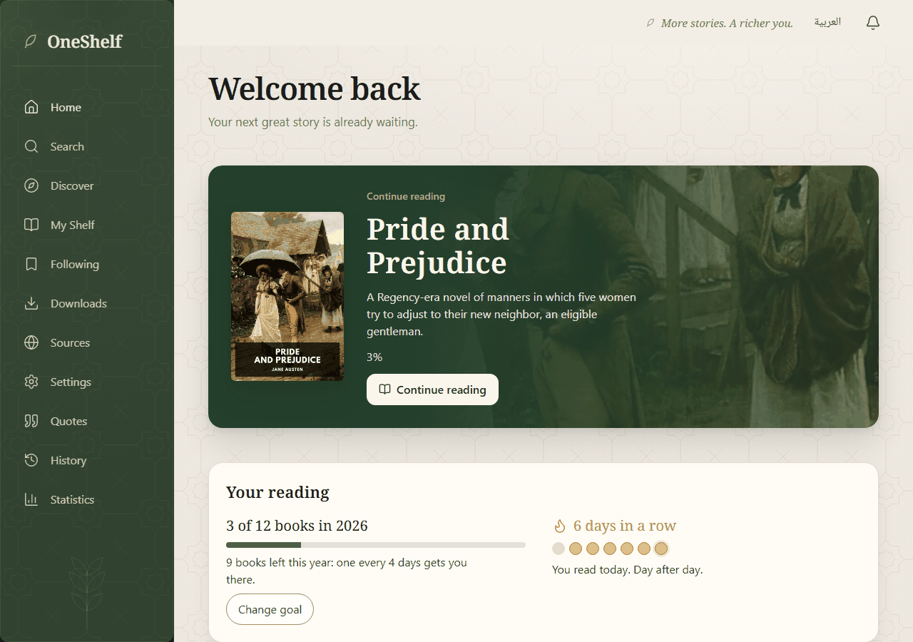
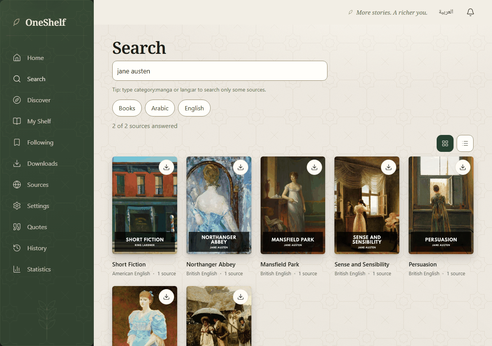
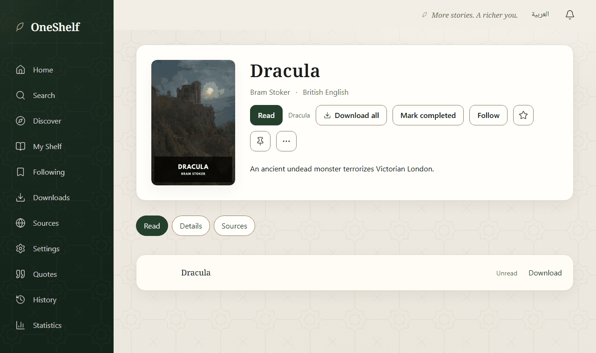
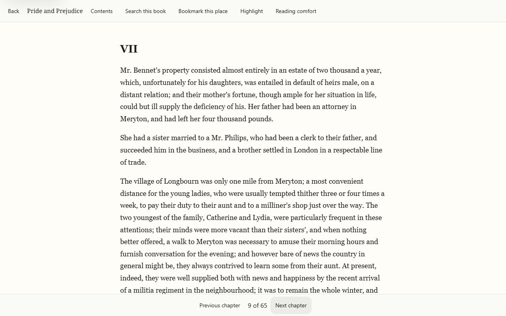
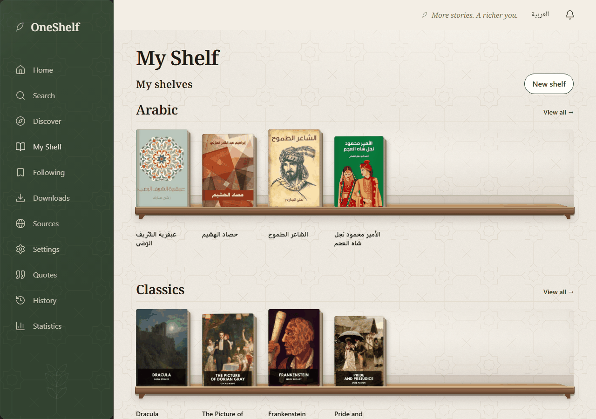
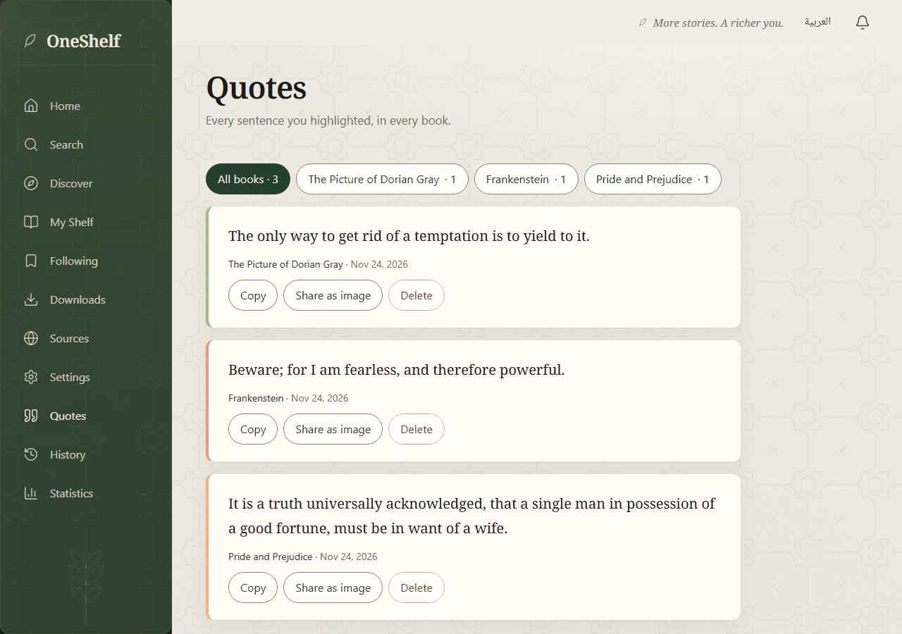
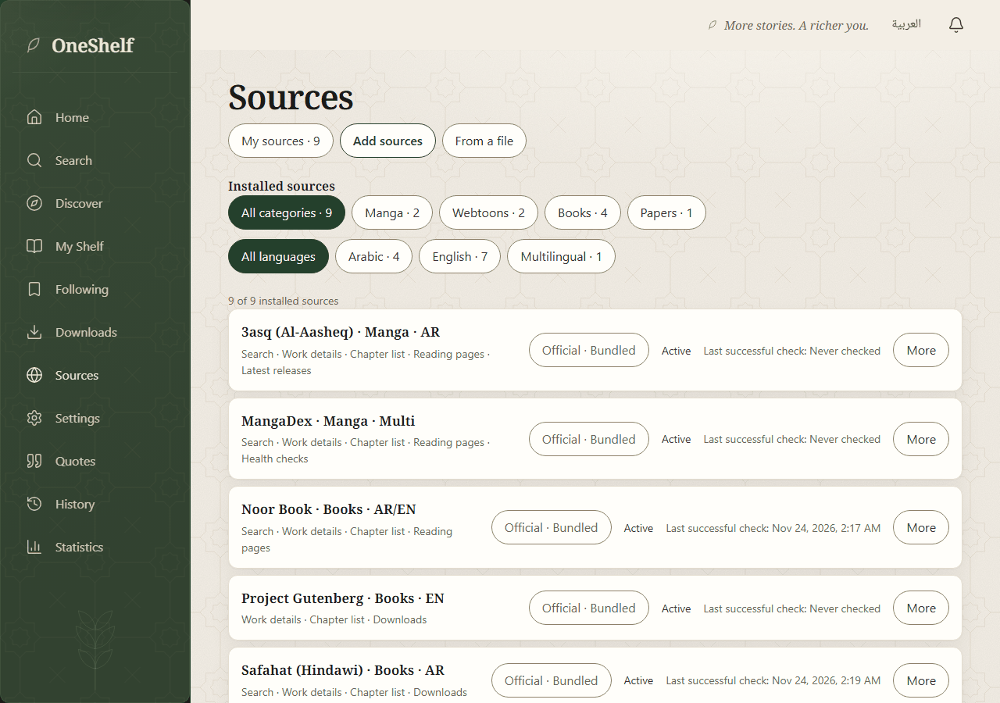
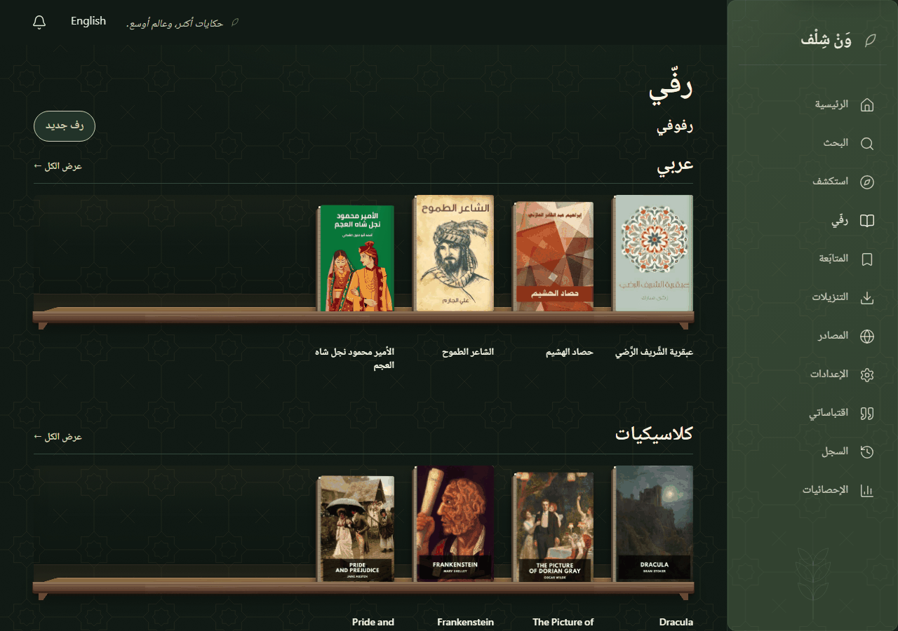

# OneShelf

A private reading library that runs on your own computer.

OneShelf puts manga, webtoons, books and papers on one shelf. It searches the sources you choose, downloads
what you ask for, remembers where you stopped, and tells you when something you follow has a new chapter.
There is no account and no cloud service, and nothing is sent anywhere. Your library is a folder on your
own disk that you can back up or move whenever you like.



<sub>The books in these pictures are public-domain and freely licensed titles (Standard Ebooks and Hindawi).
The reading goal and streak are sample data.</sub>

## What you can do with it

* **Search every source at once.** Type a title or an author; results from all your sources arrive in one list,
  and the same book found in two places is shown once.
* **Read in the app.** Pick up exactly where you left off. Bookmark a page, highlight a sentence, search inside a
  book, and adjust the text size and colours to what is comfortable.
* **Download to keep.** Download one chapter or a whole book, then read it with no connection.
* **Keep shelves.** Put books on *My Shelf*, sort them into shelves of your own, mark favourites, and set a
  yearly reading goal.
* **Not sure what to read?** Ask *What should I read now?* and pick a mood: pick up where you left off,
  something short, something light, or something you have not started. It only suggests from your own shelf,
  and tells you why.
* **Follow what you like.** *Follow* a series and new chapters show up for you.
* **Collect quotes.** Every highlight, from every book, on one page. Copy it, or save it as an image to share.
* **Use it in English or Arabic.** The interface switches language, including right-to-left layout, and has a
  dark theme.

## A quick look

| | |
|---|---|
|  |  |
| **Search.** One box for all your sources. Download straight from the results. | **A book's page.** Read it, download it, follow it, or put it on a shelf. |
|  |  |
| **The reader.** A quiet page; contents, search, bookmarks, highlights and comfort settings are one tap away. | **My Shelf.** Your books on shelves you name yourself. |
|  |  |
| **Quotes.** The sentences you highlighted, with where they came from. | **Sources.** See what each source can do, and switch any of them off. |

The whole interface also works in Arabic, in light or dark:



## Getting started

You need a Linux computer with **Podman** or **Docker** (with Compose), Git, and about 3 GB of free disk for the
program itself, plus room for your library. OneShelf will not install a container runtime for you; if neither is
found, it tells you what to do.

```sh
git clone https://github.com/IPurplel/OneShelf.git
cd OneShelf
./install.sh
```

Then open **<http://127.0.0.1:8420>**. The first run builds the image and takes a few minutes; after that it
starts in seconds.

On Windows or macOS you can run OneShelf from source; see [docs/development.md](docs/development.md).
Docker Desktop has not been tested.

### Your first few minutes

1. On first open, Home shows **One step left**. Choose **Finish setup** and pick where your library should
   live. Downloads need that folder before they can start.
2. Open **Search** and look for something you want to read.
3. Click the download arrow on a result, or open the book and choose **Download** (or **Download all**).
4. Choose **Read**. OneShelf remembers your place, and the book appears under *Continue reading* on Home.
5. Use **Add to shelf** to keep it. To sort it into a shelf of your own, open **More** and choose
   **Add to a shelf…**.
6. On a series you like, choose **Follow** to be told when something new arrives.

### Your library, backups and other devices

* Everything OneShelf keeps lives in a few folders on your disk, outside the container, so updating or removing
  the container never touches your books. [docs/operations.md](docs/operations.md) lists them and explains how to
  move them to a bigger disk.
* OneShelf makes a backup of your shelf, progress and settings every week. A full backup that also includes
  book files is available when you want one. Copy the `keys` folder yourself too; it is deliberately kept out of
  backups. [Backups in docs/operations.md](docs/operations.md)
* Your phone or tablet can use it on your home network. Open `http://<this computer's address>/` after trusting
  your network in `.env`. The steps are in [docs/operations.md](docs/operations.md#4-access). Visitors from
  outside your network need a passkey you set up in **Settings**.

### Updating and removing

```sh
./update.sh       # update to the latest version, keeping your library
./uninstall.sh    # stop OneShelf, keeping your library
```

Back up before updating. If you do want everything gone, `./uninstall.sh --delete-data` lists exactly what it
will delete and asks you to confirm. The details, including troubleshooting, are in
[docs/operations.md](docs/operations.md).

## Sources

Nine sources are included and switched on the first time you run OneShelf:

| Source | What it offers | Languages |
|---|---|---|
| MangaDex | manga | many |
| 3asq (Al-Aasheq) | manga | Arabic |
| WEBTOON, Tapas | webtoons | English |
| Safahat (Hindawi) | books | Arabic |
| Project Gutenberg, Standard Ebooks | books | English |
| Noor Book | books, read online | Arabic, English |
| arXiv | scientific papers | English |

Open **Sources** to see exactly what each one can do, switch any of them off, or remove it; a source you remove
stays removed. Each source is a small description file, not a program, and one that asks for more than it had
before waits for your approval. More sources can be added from the
[OneShelf-Adapters](https://github.com/IPurplel/OneShelf-Adapters) registry. What each source can and cannot do
is written down in [docs/source-capability-ledger.md](docs/source-capability-ledger.md).

## What OneShelf will not do

It does not get around paywalls, DRM, CAPTCHAs or anti-bot systems, and it does not pretend to be a browser it
is not. Where a site's `robots.txt` says no, OneShelf does not do it. It is also gentle with the sites it uses:
it limits how fast it asks and backs off when a site pushes back. There is no telemetry and no account.

Please use it for things you have the right to read.

## Documentation

| | |
|---|---|
| [docs/operations.md](docs/operations.md) | install details, storage, backups, access from other devices, upgrades, troubleshooting |
| [docs/development.md](docs/development.md) | running from source, tests, settings |
| [docs/plugins.md](docs/plugins.md) | how sources work, and how to write one |
| [docs/api.md](docs/api.md) | the HTTP API |
| [docs/performance.md](docs/performance.md) | what was measured and sped up (in Arabic), with the [full study](docs/PERFORMANCE_STUDY.md) |
| [docs/screenshots](docs/screenshots/README.md) | how the pictures above were made |

## Licence

No licence has been chosen yet. Until one is added, the default applies: the code is published for you to read,
and no rights to use, modify or redistribute it are granted. If you intend others to use OneShelf, add a
`LICENSE` file; that choice is yours to make, not one this repository should assume.
